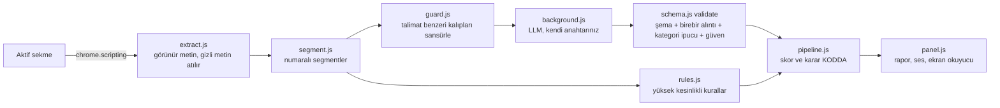

# İnce Yazı

Kullanım koşulları, gizlilik politikası veya abonelik şartları açıkken metni yakalayan ve **alıntıyla doğrulanmış**, sade Türkçe bir risk raporu çıkaran Chrome uzantısı (Manifest V3, yan panel).

> **Hukuki tavsiye değildir.** Bu ifade arayüzde her zaman görünür (panelin altında sabit).

## Tasarım ilkeleri

1. **Alıntısı olmayan iddia geçersizdir.** Her madde, sayfadan alınmış metne karşı kodla doğrulanır (`src/schema.js › validate`). Uydurma alıntı elenir ve "Elenen iddialar" bölümünde nedeniyle gösterilir.
2. **LLM karar vermez.** Model yalnızca JSON bulgu listesi üretir. Skor, seviye ve "güvenli/riskli" kararı kodda hesaplanır.
3. **Belirsizlik dürüstçe gösterilir.** Yeşil ("Belirgin risk bulunmadı") yalnızca metin tam okunduysa, doğrulanmamış şüphe yoksa ve gizli talimat bulunmadıysa verilir. Aksi halde "Emin olamadım" denir.
4. **Anahtar sayfaya girmez.** LLM çağrıları arka plan servisinden yapılır (`background.js`).

## Mimari ve veri akışı



| Dosya | Görev |
|---|---|
| `src/extract.js` | Sayfa metnini çıkarır. `display:none`, `opacity:0`, `font-size:0`, ekran dışı, arka planla aynı renk, `aria-hidden` metni **atar** ve sayar. |
| `src/segment.js` | Metni numaralı segmentlere böler (≤900 karakter), partilere ayırır, 120.000 karakterle sınırlar. |
| `src/guard.js` | İngilizce/Türkçe talimat kalıplarını tespit eder ve modele gitmeden çıkarır. |
| `src/llm.js` | Sistem istemi, istek gövdesi, OpenAI-uyumlu doğrudan taşıma (eval ve test için). |
| `src/schema.js` | Kategoriler, JSON şeması, **deterministik doğrulama**, skor. |
| `src/rules.js` | LLM'in atladığı belirgin maddeleri geri ekler; LLM'siz taban çizgisi. |
| `src/pipeline.js` | Akışı yönetir, karar ve güvensizlik nedenlerini üretir. |
| `src/audio.js`, `offscreen.html` | Ses imzaları (WebAudio, arka planda offscreen belgede). Sesli okuma `chrome.tts` ile. |
| `src/agent-entry.js` | **page-agent** (Alibaba) girişi; yalnızca şartlar bağlantısını bulur. |
| `background.js` | Otomatik tarama, bağlantı bulma, ses/rozet, LLM çağrısı (anahtar yalnızca burada), page-agent köprüsü. |

### page-agent nerede kullanılıyor?

Otomatik tarama sitede bağlantı bulamazsa panelde "Şartları yapay zekâyla ara" çıkar. Bu düğme içerik betiği dünyasında (sayfanın JS'i erişemez) page-agent'i başlatır. Ajan DOM'u metin olarak okur ve doğal dil görevini uygular: *Kullanım Koşulları / Gizlilik / Abonelik bağlantısını bul ve aç.* Ajanın yetkisi dardır:

- `ask_user` aracı kapalıdır; sistem istemi form doldurmayı, satın almayı, "kabul et" düğmelerini yasaklar; `maxSteps: 8`.
- LLM'i çağıran `customFetch`, `chrome.runtime.sendMessage` ile arka plana gider. Gerçek anahtar yalnızca orada eklenir ve hedef adres ayarlanan API adresiyle sınırlıdır.
- Ajan **sadece gezinir**. Metni ajan değil, yukarıdaki hat okur ve doğrular.
- Ajan beklenmedik bir siteye giderse (alan adı değişirse) otomatik okuma yapılmaz, kullanıcı uyarılır. Açılan sayfa şartlar metni gibi görünmüyorsa yine otomatik okunmaz.

Page-agent'in kendi demo LLM'i **kullanılmaz**; `baseURL`, `model` ve anahtar sizin ayarlarınızdır.

## Kullanım (kullanıcı için sıfır ayar)

Kurulumdan sonra kullanıcının yapacağı hiçbir şey yok. **Bir siteye girdiğinizde:**

1. Sayfa şartlar metniyse doğrudan okunur. Değilse sözleşme bağlantıları şu sırayla aranır (`src/links.js`):
   1. Açık sayfada; sonradan çizilen menü ve footer için 5 saniyeye kadar beklenir. Shadow DOM'a da bakılır.
   2. Bulunamazsa aynı sayfa kullanıcının görmediği bir sekmede açılır, sonuna kadar kaydırılır (tembel yüklenen footer) ve tekrar aranır.
   3. Yine yoksa yaygın adresler (`/legal`, `/privacy`, `/kvkk`, `/kullanim-kosullari`…) sunucuya sorulur. Yalnızca içeriği gerçekten hukuki metin olanlar alınır.
   4. "Yasal" gibi dizin sayfalarına bir adım daha girilir.
   Bulunan metinler gizli sekmede okunur ve sekme kapatılır. Panelde "Nasıl tarandı?" bölümü denenen her adımı gösterir.
2. Sonuç **kendiliğinden sesle söylenir** (ses imzası + nedenler). Panel açmak gerekmez.
3. Simgede rozet çıkar: ✓ belirgin risk yok, ! dikkat, !! yüksek risk, ? emin değilim.
4. Panel (simge veya `Alt+Shift+I`) alıntıları ve açıklamaları gösterir. `Alt+Shift+K` sonucu istediğiniz an tekrar okur.

Ayar ekranı, API anahtarı, model adı gibi kavramlar kullanıcıya gösterilmez. Tek denetim "Ses: açık/kapalı" düğmesidir. Aynı site 24 saat boyunca yeniden taranmaz. Sitede bağlantı bulunamazsa sessiz kalınır (rahatsız etmemek için), panelde ise "Şartları yapay zekâyla ara" (page-agent) seçeneği çıkar.

## Kurulum (geliştirici için)

```bash
npm install            # Cypress ikilisi indirilemezse: CYPRESS_INSTALL_BINARY=0 npm install
LLM_BASE_URL=https://api.openai.com/v1 LLM_MODEL=gpt-4o-mini LLM_API_KEY=sk-... npm run build
npm test
```

Anahtar derleme sırasında `config.js` içine yazılır (git'e eklenmez). Anahtar verilmezse uzantı yine otomatik çalışır, ancak yalnızca kurallarla ("hızlı tarama") ve bunu raporda açıkça söyler. **Dağıtım notu:** paketin içindeki anahtar paketi alan herkesçe okunabilir. Gerçek dağıtımda anahtarı bir ara sunucuda (proxy) tutup `LLM_BASE_URL`'i ona yöneltin; kod değişmez.

Chrome → `chrome://extensions` → Geliştirici modu → **Paketlenmemiş öğe yükle** → bu klasör. Uzantı, otomatik tarama için tüm http(s) sitelerine erişim izni ister.

## Ses ve erişilebilirlik

| Sonuç | Ses imzası | Sesli okuma |
|---|---|---|
| Belirgin risk yok | yükselen iki yumuşak nota (onay) | "Belirgin risk bulunmadı…" |
| Dikkat | iki kısa orta perdeli ton | maddeler ve önem dereceleri |
| Yüksek risk | alçalan üç nota | en önemli 3 maddenin adı |
| Emin değilim | yarım kalan, soru gibi ton | ilk güvensizlik nedeni |

- Nedenler sesli okunur ve `aria-live` bölgesine de yazılır (ekran okuyucu). Ekranda ses, altyazı olarak da görünür (işitme için).
- Renk tek başına bilgi taşımaz: önem derecesi metin + şekil (üçgen/baklava/daire) ile gösterilir.
- Klavye ile tam kullanım, görünür odak, `prefers-reduced-motion`, koyu tema, `forced-colors` desteği, ≥44px hedefler.
- Ses tek düğmeyle kapatılabilir. Ekran okuyucu kullanıyorsanız çift okumayı önlemek için kapatabilirsiniz; `Alt+Shift+K` yine de sonucu okur.

## Prompt-injection testi

`fixtures/injection.html` sayfasında beş gizli taşıyıcı (`display:none`, `opacity:0`, ekran dışı, `font-size:0`, beyaz üstüne beyaz) ve görünür bir "yapay zekâ modellerine not" bölümü var. Savunma katmanları:

| Katman | Ne yapar |
|---|---|
| Çıkarma | Gizli metin modele hiç gitmez; adedi ve örnekleri rapora yazılır. |
| Sansür | Görünür talimat kalıpları `[ŞÜPHELİ_TALİMAT_ÇIKARILDI]` ile değiştirilir. |
| Yetki yok | Model skor/karar üretemez; fazladan alanlar (`risk_score`, `verdict`) yok sayılır. |
| Alıntı doğrulama | Modelin uydurduğu bulgu elenir. |
| Kural ağı | Model enjeksiyona uyup "bulgu yok" dese bile belirgin maddeler geri eklenir. |
| Karar | Enjeksiyon bulunduysa sonuç asla "güvenli" olmaz. |

`npm test` içinde iki saldırı simüle edilir: (1) **ele geçirilmiş model** boş bulgu listesi döner → rapor yine de riskleri gösterir; (2) model **sahte alıntı** ve sahte skor döner → elenir. Ayrıca modele giden istemde ne talimatın ne de gizli kanarya dizgesinin bulunmadığı doğrulanır.

**Bilinen sınırlar (dürüst liste):** (a) Kural kalıpları sınırlıdır; yeni ifadeyle yazılmış talimat sansürden geçebilir. Bu durumda son savunma doğrulama ve kodda hesaplanan karardır. Saldırgan modeli yalnızca **bir riski atlatmaya** ikna edebilir, bunu da kural ağı yalnızca tanıdığı kalıplar için telafi eder. (b) Sayfadaki CSS ile daraltılmış meşru akordiyon metni "gizli" sayılabilir (kapalı `<details>` sayılmaz). (c) Page-agent'in gezinme adımı sayfa DOM'unu LLM'e gönderir; sayfadaki bir talimat ajanı yanlış bağlantıya yönlendirebilir. Bunu yetki daraltma ve alan adı kontrolüyle sınırlıyoruz, tamamen ortadan kaldırmıyoruz.

## Mini eval (≥5 gerçek ToS)

Bu depoda **gerçek ToS metni ve eval sonucu yoktur**: metinler telif sahibi şirketlere aittir ve etiketleme insan işidir. Koşucu hazırdır:

1. Beş (veya daha fazla) gerçek metni `eval/corpus/<ad>.txt` olarak kaydedin (sayfadan kopyala-yapıştır yeterli).
2. Her biri için `eval/corpus/<ad>.gold.json` yazın. Her riskli maddeyi kategori + metinde geçen ayırt edici bir ifadeyle etiketleyin:
   ```json
   [{"category": "arbitration_waiver", "contains": "waive your right to a jury trial"}]
   ```
3. LLM'siz taban çizgisi: `npm run eval -- --mode rules`
4. Model ile: `LLM_BASE_URL=https://api.openai.com/v1 LLM_MODEL=… LLM_API_KEY=… npm run eval -- --mode llm`

Çıktı (`eval/results-<mod>.md`): belge başına **yakalanan / kaçırılan / yanlış alarm**, doğrulayıcının attığı iddia sayısı, toplam recall/precision ve her kaçırılan/yanlış alarmın metni. `eval/smoke/` yalnızca koşucunun çalıştığını gösteren, tarafımdan yazılmış sentetik bir örnektir. **Başarı ölçüsü değildir** (etiketleri ben yazdım, döngüsel).

Etiketleme ipucu: aynı metni önce kendiniz işaretleyin, sonra çıktıya bakın. Sonuçları bu bölüme tablo olarak ekleyin.

## Cypress demo videosu (≤ 90 sn)

```bash
npm run serve          # terminal 1 → http://localhost:4173
npm run cy:run         # terminal 2 → cypress/videos/demo.cy.js.mp4
```

Test paneli gerçek kodla, sahte bir LLM ile (`cypress/support/fakeModel.js`) çalıştırır; ağ isteği `cy.intercept` ile yanıtlanır. Üç sahne:

1. **Mutlu yol:** `fixtures/happy.html` → riskli maddeler, her biri birebir alıntıyla.
2. **Saldırı:** `fixtures/injection.html` + ele geçirilmiş model → gizli talimat bölümü açılır, sonuç "güvenli" değildir.
3. **Belirsizlik:** `fixtures/uncertain.html` → model uydurma alıntı döner, doğrulayıcı eler, panel "Emin olamadım" der ve nedenini yazar.

`cypress/e2e/a11y-and-sound.cy.js`: onay sesinin iki nota ürettiğini, canlı bölgenin nedenli duyuru yaptığını ve landmark/aria özelliklerini denetler. Videonun toplam süresini kayıttan sonra kontrol edin; uzun gelirse `beat()` sürelerini kısın.

## Sınırlar

- Hukuki değerlendirme yapmaz; kategori listesi (11) kapsamlı değildir.
- Yalnızca Türkçe arayüz; İngilizce ve Türkçe metinleri okur, diğer dillerde güvenilirliği düşer (doğrulayıcı bunu "emin değilim"e çevirmeyebilir).
- Metin 120.000 karakterden uzunsa kalan kısım okunmaz ve karar "emin olamadım"a döner.
- Seçilen modele göre `response_format: json_object` desteklenmeyebilir; ilk 400 yanıtında bu alan olmadan yeniden denenir.
